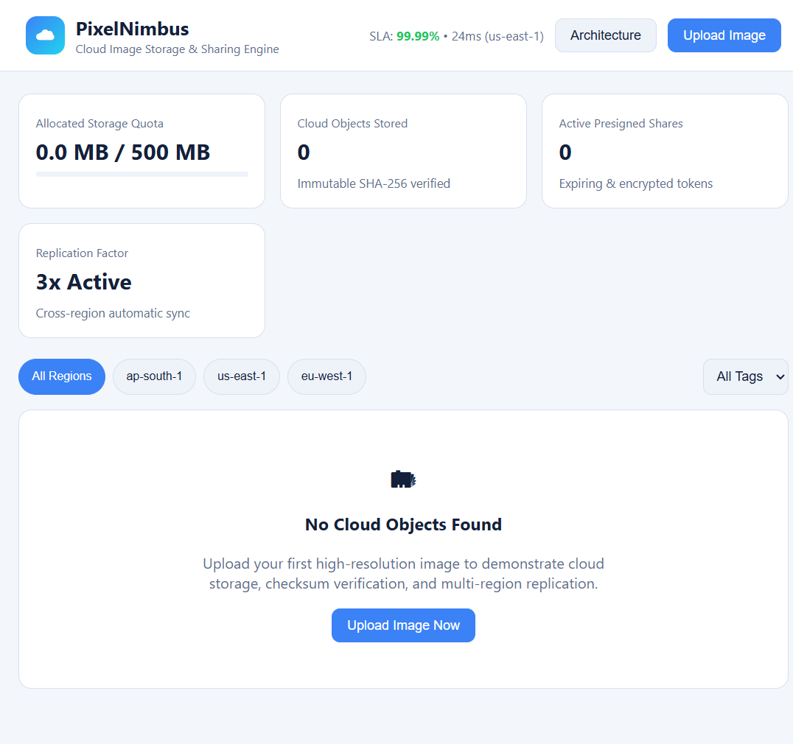

# PixelNimbus

PixelNimbus is a browser-based image storage and sharing demo. Its dashboard presents cloud-storage concepts such as object metadata, regions, storage classes, checksums, and expiring share links.



## Run locally

No package installation or build step is required. With Python 3 installed, open PowerShell in this project folder and start a local static web server:

```powershell
python -m http.server 8000
```

Open [http://localhost:8000](http://localhost:8000) in a modern browser. Stop the server with `Ctrl+C`.

You can also open `index.html` directly, but serving the files locally is recommended because browser cryptography and storage APIs may be restricted for file URLs.

## Using the demo

- Choose **Upload Image** (or drag images into the drop zone) to add images. Each file must be an image no larger than 25 MB; the displayed storage quota is 500 MB per browser.
- Select a primary region and storage class, and optionally add comma-separated tags before uploading.
- Use the region and tag filters to browse uploaded images. Select an image to inspect its metadata, download it, share it, or delete it.
- Share links can be configured with an expiration, optional passcode, and download permission. The QR code is provided by an external CDN and requires an internet connection.
- Uploaded files and share records are stored in the browser's IndexedDB. They remain available in that browser profile until its site data is cleared.

## What this project demonstrates

- Browser-side image validation, upload progress, and storage quota tracking.
- SHA-256 checksums computed with the Web Crypto API.
- Object metadata, region and storage-class selection, and tag-based filtering.
- Share tokens with expiration settings, optional passcode verification, and QR-code display.
- Responsive dashboard, image details, and upload/share dialogs.

## Prototype limitations

This is a front-end simulation, not a connected cloud-storage service. Data stays in one browser's IndexedDB; share links do not make an image available to another browser or device. The region selectors, replication indicators, storage classes, SLA figures, and upload pipeline are illustrative only. There is no AWS/S3 integration, server-side API, real multipart transfer, cross-region replication, server-side encryption, or production presigned-URL security. A passcode is hashed locally for the demo and does not encrypt the image.

The QR-code library is loaded from cdnjs, so that feature may be unavailable offline. Other app functionality is served from the local project files.
